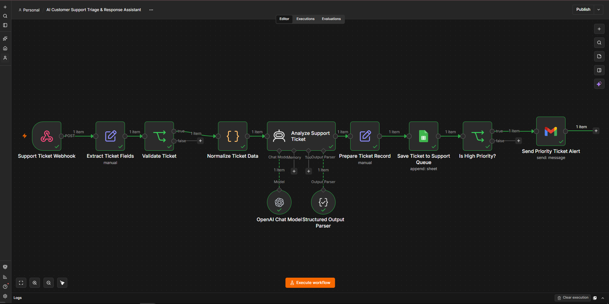
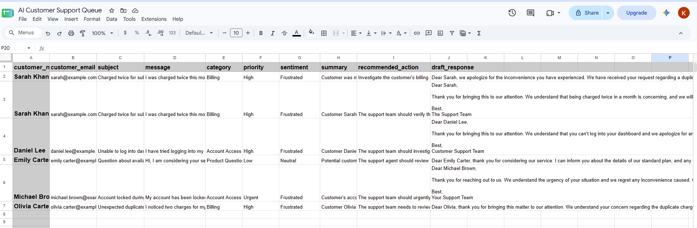
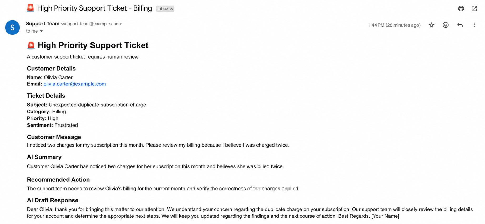

# AI Customer Support Triage & Response Assistant

An AI-powered customer support automation built with **n8n, OpenAI, Google Sheets, and Gmail**.

The workflow receives customer support tickets through a webhook, validates and normalizes the incoming data, uses an OpenAI model to classify and analyze the ticket, stores structured results in a support queue, and automatically alerts the support team when a ticket is classified as **High** or **Urgent** priority.

The system is designed as a **human-in-the-loop support assistant**. AI-generated analysis and draft responses are intended for human review rather than automatic customer-facing action.

## Workflow Overview



## Automation Flow

```text
Support Ticket Webhook
        ↓
Extract Ticket Fields
        ↓
Validate Ticket
        ↓
Normalize Ticket Data
        ↓
Analyze Support Ticket
        ├── OpenAI Chat Model
        └── Structured Output Parser
        ↓
Prepare Ticket Record
        ↓
Save Ticket to Support Queue
        ↓
Is High Priority?
        ├── High / Urgent → Send Priority Ticket Alert
        └── Low / Medium → No priority alert
```

## What the Workflow Does

### 1. Ticket Intake

A POST webhook receives structured customer support data including:

- Customer name
- Customer email
- Subject
- Message

### 2. Validation

The workflow checks that required information is present before sending a ticket through AI processing.

Invalid tickets are routed away from the main processing path.

### 3. Data Normalization

A JavaScript Code node cleans and normalizes incoming ticket fields before AI analysis.

### 4. AI Ticket Analysis

The ticket is analyzed using an OpenAI chat model.

The model returns structured information containing:

- `category`
- `priority`
- `sentiment`
- `summary`
- `recommended_action`
- `draft_response`

A Structured Output Parser is used to keep the AI response consistent and machine-readable.

### 5. Ticket Classification

The workflow supports the following categories:

- Billing
- Technical Support
- Account Access
- Cancellation
- Product Question
- Complaint
- Other

Priority is classified as:

- Low
- Medium
- High
- Urgent

Sentiment is classified as:

- Positive
- Neutral
- Frustrated
- Angry

### 6. Support Queue

After analysis, the original ticket information and AI-generated fields are combined into a structured record and appended to Google Sheets.

Google Sheets acts as a lightweight support queue for this project.

## Support Queue Results



The test data demonstrates different ticket types and priority levels, including:

- Billing → High
- Account Access → High
- Product Question → Low
- Account Access → Urgent

### 7. Priority Routing

An IF node checks the AI-generated priority.

Tickets classified as:

```text
High OR Urgent
```

are routed to the priority notification path.

Low and Medium priority tickets are stored in the support queue without triggering the priority email alert.

### 8. Priority Email Alert

High and Urgent tickets automatically generate a formatted Gmail notification for human review.

The notification contains:

- Customer details
- Ticket details
- Original customer message
- AI summary
- Recommended action
- AI-generated draft response
- Human-review notice

## Priority Ticket Alert



## Human-in-the-Loop Safeguards

The workflow intentionally does **not** allow the AI to autonomously perform customer account or financial actions.

Prompt safeguards instruct the model not to claim that actions such as refunds, cancellations, credits, replacements, payment adjustments, or account changes have already been completed.

The AI-generated response is treated as a **draft for human review**.

The priority notification also explicitly reminds the support agent to verify the ticket before taking action or sending a response.

## Testing

The workflow was tested with multiple scenarios.

| Test Scenario | AI Classification | Priority | Expected Routing | Result |
|---|---|---|---|---|
| Duplicate subscription charge | Billing | High | Priority alert | Passed |
| Dashboard login problem | Account Access | High | Priority alert | Passed |
| General feature question | Product Question | Low | No priority alert | Passed |
| Locked account with immediate deadline | Account Access | Urgent | Priority alert | Passed |
| Missing required email | Validation failure | — | Stop processing | Passed |

Testing verified both priority-routing branches as well as the validation path.

## Tools & Technologies

- **n8n** — workflow orchestration
- **OpenAI** — support ticket analysis
- **Structured Output Parser** — consistent AI output
- **JavaScript** — data normalization
- **Google Sheets** — lightweight support queue
- **Gmail** — priority notifications
- **Webhook / JSON** — ticket intake

## Repository Structure

```text
ai-customer-support-triage-response-assistant/
├── README.md
├── screenshots/
│   ├── priority-ticket-alert.png
│   ├── support-queue-results.png
│   └── workflow-overview.png
└── workflow/
    └── ai-customer-support-triage-response-assistant.json
```

## Workflow Export

A sanitized n8n workflow export is included in:

```text
workflow/ai-customer-support-triage-response-assistant.json
```

Credential references and environment-specific information have been removed or replaced for public portfolio use.

After importing the workflow into n8n, users must configure their own OpenAI, Google Sheets, and Gmail credentials and update the required Google Sheets configuration.

## Limitations

This is a portfolio implementation rather than a production customer-support platform.

Current limitations include:

- Google Sheets is used instead of a dedicated ticketing system.
- AI classifications can require human verification.
- Invalid tickets currently stop rather than entering a separate error-handling queue.
- Low and Medium priority tickets do not trigger notifications.
- The workflow does not automatically send AI-generated responses to customers.
- Production deployments would require additional monitoring, security, retry logic, access controls, and error handling.

## Potential Improvements

Future versions could include:

- Zendesk, Freshdesk, or another ticketing-platform integration
- SLA tracking
- Automatic ticket assignment
- Dedicated invalid-ticket/error handling
- Escalation rules based on category and priority
- Knowledge-base retrieval
- Human approval workflows
- Analytics dashboards
- Retry and failure-handling logic
- More extensive evaluation of AI classification accuracy

## Project Status

**Portfolio Ready**

Core workflow behavior has been implemented and tested across multiple ticket scenarios, including validation, AI analysis, structured output, support queue storage, priority routing, and email notifications.
